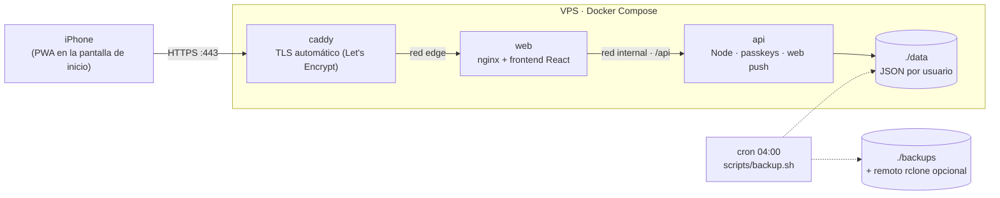

# openGym en un VPS

Despliegue listo para producción de [openGym](https://github.com/DuarteSantos8/openGym), un tracker
de gimnasio autoalojado, en un VPS propio con HTTPS automático, firewall, respaldos diarios y
actualizaciones con un comando.

Lo uso en el iPhone como app instalada desde Safari (PWA): login con Face ID (passkey), funciona sin
señal dentro del gimnasio y sincroniza cuando vuelve la conexión.

## Arquitectura



| Servicio | Imagen | Rol |
|---|---|---|
| `caddy` | `caddy:2.11-alpine` | Único contenedor con puertos abiertos (80/443). Emite y renueva el certificado, fuerza HTTPS (HSTS), comprime y sirve HTTP/3. |
| `web` | `ghcr.io/duartesantos8/opengym-web` | nginx sirve la PWA y hace proxy de `/api` en el mismo origen, que las passkeys requieren. |
| `api` | `ghcr.io/duartesantos8/opengym-api` | Backend Node: WebAuthn, sesiones firmadas, sincronización con control de revisiones y notificaciones push. |

### Decisiones de diseño

- **Una sola variable de dominio.** `RP_ID` y `ORIGIN` (los dos valores donde fallan casi todas las
  instalaciones de passkeys) se derivan de `DOMAIN` en el compose, así no pueden quedar desalineados.
- **Redes separadas.** Caddy solo ve a `web` y solo `web` ve a `api`. Ningún puerto de la app queda
  expuesto en el host, así que no hay forma de saltearse el HTTPS.
- **IP real del cliente sin cabeceras falsificables.** Caddy reemplaza el `X-Forwarded-For` que
  manda el cliente por la IP real, y nginx la pasa a la API como `CF-Connecting-IP`. Así el
  rate-limit de inicio de sesión y el log de actividad cuentan visitantes y no "Caddy".
- **Arranque ordenado.** Cada servicio espera a que el anterior pase su healthcheck.
- **Versiones fijadas.** Las imágenes llevan versión exacta, y Dependabot abre un PR cuando sale una
  nueva, que pasa por CI antes de llegar al servidor.
- **Respaldos sin downtime.** openGym escribe cada archivo con un temporal más un rename atómico,
  así que un `tar` en caliente nunca ve un JSON a medias.

### Límites (por qué una sola réplica)

openGym guarda los datos como archivos JSON en un volumen, sin base de datos, así que la API corre
en **un único proceso**. Para uso personal o un grupo chico (decenas de usuarios) sobra con el VPS
más barato. Para escalar horizontalmente habría que reemplazar el almacenamiento del upstream.

## Puesta en marcha

**Requisitos:** un VPS con Ubuntu 24.04 o Debian 12 (1 vCPU y 1 GB de RAM alcanzan) y un dominio
con un registro `A` apuntando a la IP del VPS.

```bash
ssh root@IP_DEL_VPS
git clone https://github.com/<tu-usuario>/<este-repo>.git opengym && cd opengym
cp .env.example .env && nano .env      # completar DOMAIN y ACME_EMAIL
sudo ./scripts/setup-vps.sh
```

El script instala Docker desde el repositorio oficial, activa las actualizaciones automáticas de
seguridad, configura `ufw` (solo 22, 80 y 443), revisa que el DNS apunte al servidor, levanta el
stack y programa el respaldo diario.

**Después:**

1. En el iPhone, abrir `https://tu-dominio` en **Safari** → Compartir → **Agregar a pantalla de inicio**.
2. Desde el ícono, **Crear perfil** con Face ID. El primer perfil queda como admin.
3. Cerrar el registro: descomentar `INVITE_ONLY=1` en `.env` y correr `docker compose up -d`.
4. Activar las notificaciones en Ajustes → Recordatorios (en iOS solo funcionan desde el ícono de
   inicio, no desde Safari).

## Operación

| Tarea | Comando |
|---|---|
| Ver estado | `docker compose ps` |
| Logs | `docker compose logs -f api` |
| Respaldo manual | `sudo ./scripts/backup.sh` |
| Restaurar | `sudo ./scripts/restore.sh backups/opengym-AAAA-MM-DD_HHMM.tar.gz` |
| Actualizar | `sudo ./scripts/update.sh` (respalda, hace `git pull` y baja las imágenes nuevas) |

**Respaldos fuera del servidor:** instalar [rclone](https://rclone.org), configurar un remoto
(Backblaze B2, Google Drive, S3…) y definir `BACKUP_RCLONE_REMOTE=remoto:carpeta` en `.env`.
Los respaldos locales se borran después de `BACKUP_KEEP_DAYS` días.

El archivo de respaldo contiene todos los perfiles, el historial y la clave que firma las sesiones,
así que hay que guardarlo en un lugar privado.

## Probar en local

Con Docker Desktop, `DOMAIN=localhost` hace que Caddy use su propia CA en vez de Let's Encrypt:

```bash
cp .env.example .env && sed -i '' 's/^DOMAIN=.*/DOMAIN=localhost/' .env   # en Linux: sed -i
docker compose up -d --wait
curl -k https://localhost/api/health
```

## CI

[`.github/workflows/ci.yml`](.github/workflows/ci.yml) corre en cada push y PR:

- **lint:** `shellcheck` sobre los scripts, `docker compose config` y `caddy validate`.
- **smoke:** levanta el stack completo en el runner, comprueba la PWA y `/api/health` a través de
  HTTPS y genera un respaldo.

## Créditos y licencia

[openGym](https://github.com/DuarteSantos8/openGym) es de Duarte Santos y se distribuye bajo
AGPL-3.0. Este repositorio no modifica su código: usa las imágenes oficiales publicadas por el
proyecto. Los archivos de despliegue de este repo están bajo licencia [MIT](LICENSE).
